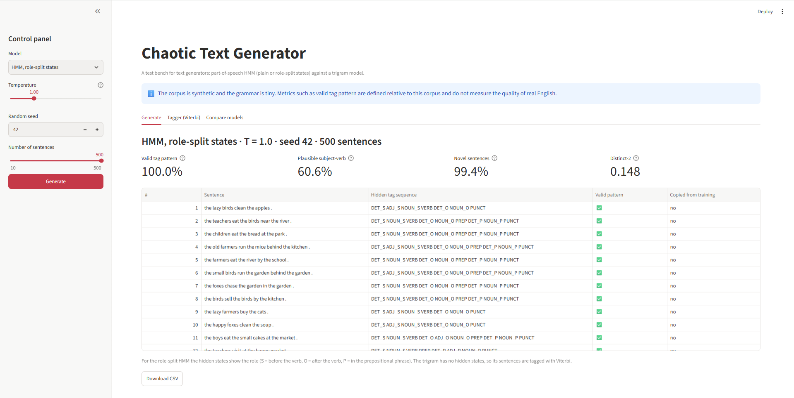
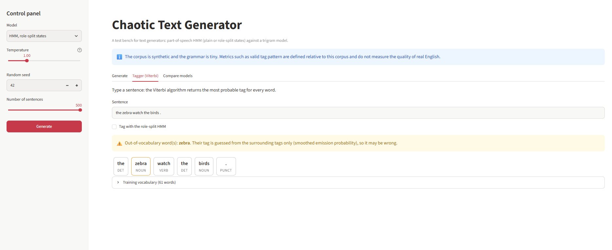
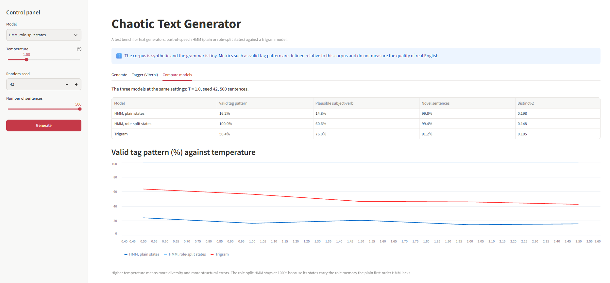

# Lab 03 - Chaotic Text Generator

A web test bench for text generators. It generates sentences with a part-of-speech **Hidden Markov Model** (plain or role-split states) or a **trigram** model, shows the hidden tag sequence behind each sentence, measures the batch with four metrics, and tags any typed sentence with the **Viterbi** algorithm.

**Live app:** https://hmm-chaotic-text-generator.streamlit.app/

> The corpus is synthetic and the grammar is tiny. Metrics such as valid tag pattern are defined relative to this corpus and do not measure the quality of real English.

## Screenshots

**Generator** - role-split HMM, T = 1.0, seed 42, 500 sentences: metrics, hidden tag sequences and valid-pattern marks.



**Viterbi tagger** - an out-of-vocabulary word ("zebra") triggers a warning, and the app still tags the sentence.



**Model comparison** - the three models at the same settings, and valid tag pattern against temperature.



## Features

- Control panel: model (plain HMM, role-split HMM, trigram), temperature, random seed, number of sentences (10-500)
- Generation table: sentence, hidden tag sequence, valid-pattern mark, copied-from-training flag
- Metrics: valid tag pattern, plausible subject-verb, novelty, distinct-2
- Viterbi tagger with an out-of-vocabulary warning
- CSV download of the generated sentences
- Model comparison table and a plot of valid tag pattern against temperature

## Run locally

```bash
python -m venv venv
venv\Scripts\activate          # Windows  (Linux/macOS: source venv/bin/activate)
pip install -r requirements.txt
streamlit run app.py
```

## Evaluation scripts

```bash
python -m src.evaluate         # synthetic corpus: metrics at T = 0.5, 1.0, 1.5, 2.5
python -m src.evaluate_real    # real text: Universal Dependencies English EWT
```

## Results (T = 1.0, 500 sentences, seed fixed)

| Model                  | Valid tag pattern | Plausible subject-verb | Novel sentences | Distinct-2 |
|------------------------|------------------:|-----------------------:|----------------:|-----------:|
| HMM, plain states      | 16.2%             | 14.8%                  | 99.8%           | 0.198      |
| HMM, role-split states | 100%              | 60.6%                  | 99.4%           | 0.148      |
| Trigram                | 57.0%             | 76.0%                  | 91.2%           | 0.105      |

Real text (UD English EWT, 2,077 test sentences):

| Model             | Accuracy | Known words | Unknown words | Whole sentence |
|-------------------|---------:|------------:|--------------:|---------------:|
| Most-frequent tag | 86.2%    | 90.8%       | 28.6%         | 31.9%          |
| HMM + Viterbi     | 88.0%    | 92.9%       | 28.2%         | 40.4%          |

## Project structure

```
app.py               Streamlit application
src/pipeline.py      HMM, Viterbi, trigram generator, metrics
src/evaluate.py      evaluation on the synthetic corpus
src/evaluate_real.py evaluation on UD English EWT
data/corpus.csv      tagged synthetic corpus (1,200 sentences, 6 tags)
results/             metrics, failures and plots
screenshots/         screenshots of the application
```